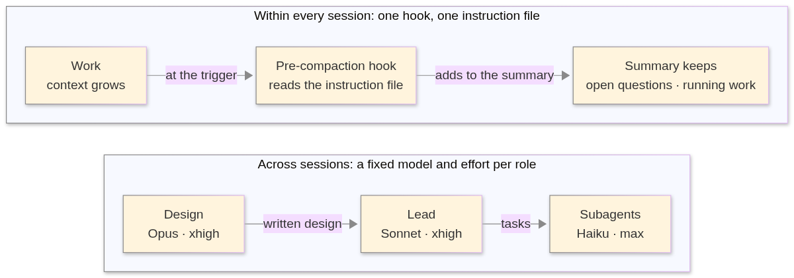

# Agent session reference

Long-running Claude Code sessions that keep their context, and a team of sessions with a fixed model per role. Two settings files, one hook, no scripts to run.

## Why

- **Sessions run on.** Compaction fires early, so every turn stays small and the session never stops for a manual reset.
- **Nothing important is lost.** Open questions and running work survive every summary.
- **A fixed model per role.** Opus designs, Sonnet leads, Haiku does the small tasks.
- **One Lead merges.** Parallel sessions never compete for `main`.
- **Enforced, not requested.** Role files, launch commands and one hook keep the roles in place.

## Quick start

| # | Step | Result |
|---|---|---|
| 1 | Copy [`.claude/`](.claude) into your repo, or merge `settings.json` into yours | compaction fires at about 250k tokens |
| 2 | Start a new session and run `/compact` | the summary contains the two added sections |
| 3 | Add the three role files from [inter-session management](docs/inter-session-management.md) | each role has its model |
| 4 | Start the Lead: `claude --agent lead --effort xhigh` | a Sonnet session at xhigh effort |

## What is in here

| Path | What |
|---|---|
| [`.claude/settings.json`](.claude/settings.json) | the compaction window and trigger, and the pre-compaction hook |
| [`.claude/compact-instructions.md`](.claude/compact-instructions.md) | the text the hook hands to Claude Code: what every summary keeps |

## What works

Tested with Claude Code 2.1.322.

| Part | Status |
|---|---|
| Pre-compaction hook and instruction file | tested |
| Role files set the session's model | tested |
| Subagent file sets the subagent's model | tested |
| Hook locks subagent calls to the defined roles | tested |
| Effort levels, organisation-wide settings | documented by Claude Code, not tested here |

## Where next

| Doc | Read it to |
|---|---|
| [Intra-session management](docs/intra-session-management.md) | set up compaction and see how a summary is built |
| [Inter-session management](docs/inter-session-management.md) | set up the three roles and enforce their models |
