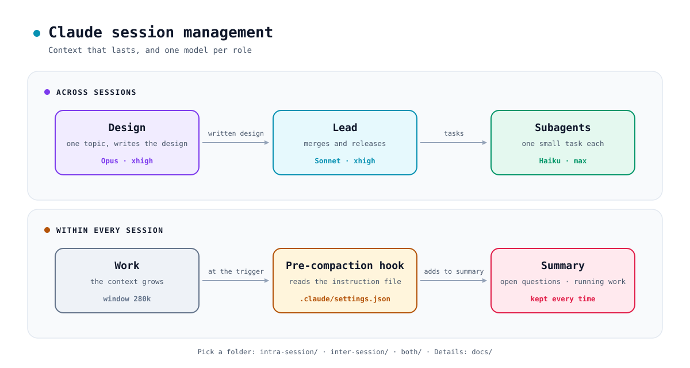

# Claude session management

Long-running Claude Code sessions that keep their context, and a team of sessions with a fixed model per role. Settings, three role files and two hooks. The subagent hook needs `jq`.

<picture>
  <source media="(prefers-color-scheme: dark)" srcset="docs/assets/overview-dark.svg">
  <source media="(prefers-color-scheme: light)" srcset="docs/assets/overview-light.svg">
  
</picture>

## Why

- **Sessions run on.** Compaction fires early, so every turn stays small and no one resets a session by hand.
- **Nothing important is lost.** Open questions and running work survive every summary.
- **A fixed model per role.** Opus designs, Sonnet leads, Haiku does the small tasks.
- **One Lead merges.** Parallel sessions never compete for `main`.
- **Enforced, not requested.** Role files, launch commands and a hook keep the roles in place.

## What is in here

```text
.claude/
├─ settings.json              compaction window and trigger, the two hooks
├─ compact-instructions.md    what every summary keeps
├─ agents/
│  ├─ design.md               Opus · xhigh
│  ├─ lead.md                 Sonnet · xhigh
│  └─ worker.md               Haiku · max (the subagent)
└─ hooks/
   └─ lock-agent.sh           only the defined subagents, no per-call overrides
```

## Quick start

1. **Copy [`.claude/`](.claude) into your repo,** or merge `settings.json` into yours.
2. **Start a Lead:** `claude --agent lead --effort xhigh`. Expect a Sonnet session at xhigh effort.
3. **Run `/compact`.** The summary contains the two added sections: open questions and running work.

## What works

Tested with Claude Code 2.1.322.

| Part | Status |
|---|---|
| Pre-compaction hook and instruction file | ✅ tested |
| Role files set the session's model | ✅ tested |
| Subagent file sets the subagent's model | ✅ tested |
| Hook locks subagent calls to the defined roles | ✅ tested |
| Effort levels, organisation-wide settings | 📖 documented by Claude Code, not tested here |

## Where next

- **[Intra-session management](docs/intra-session-management.md):** set up compaction and see how a summary is built.
- **[Inter-session management](docs/inter-session-management.md):** the three roles, their models, and how to enforce them.
