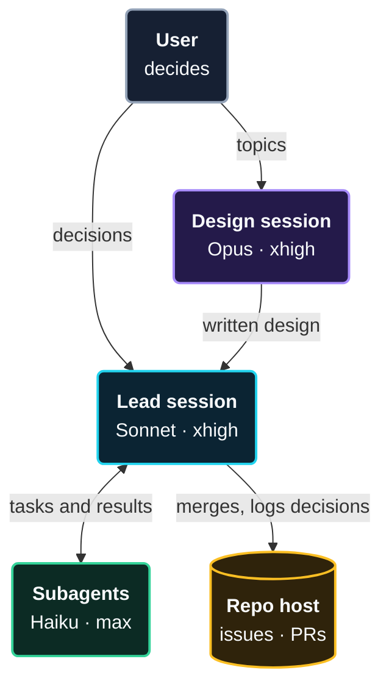

# Inter-session management

Three roles, each with a fixed model and effort: a Design session works a topic out, one Lead builds it, subagents do the small tasks. The setup enforces the roles; it does not rely on people remembering them.

> [!NOTE]
> Install: copy [`inter-session-mgmt/.claude/`](../inter-session-mgmt/.claude) into your repo, or [`full-session-mgmt/.claude/`](../full-session-mgmt/.claude) to add the compaction setup of [intra-session management](intra-session-management.md). The hook needs `jq`.

## The roles

| Role | Does | Model | Effort | How many |
|---|---|---|---|---|
| **Design** | works one topic out with the user and writes the design (doc or issue) | Opus | xhigh | one per topic |
| **Lead** | turns the design into the product: delegates, reviews code quality and results against the goal, merges, releases | Sonnet | xhigh | one per product |
| **Subagents** | each does one small, well-defined task and returns the result | Haiku | max | many, short-lived |

## How they work together



## The rules

1. **One topic per session.** A session stays small and its summaries stay accurate.
2. **One Lead per product.** Only the Lead merges to `main` and releases, so parallel sessions never compete for it.
3. **Design hands over a written design,** never code in `main`.
4. **Subagents return a result,** not a conversation, in the most minimal, clean code. The Lead reviews code quality and results against the goal and owns what gets merged.
5. **Durable state lives on the repo host** (issues, decision log, PRs), not in a session. A new session starts from there.
6. **Sessions message each other rarely:** for hand-overs, and for "`main` moved" or "release shipped".
7. **A topic moves by hand-over file:** at most 30 lines with running work, open questions, next steps and open PRs. The file lives outside the repository, for example `~/.claude/projects/<project>/handoff/<topic>.md`. A new session told "continue from `<topic>`" reads it first.
8. **Close a session** when its topic is done.

## Why one Lead, not a team of equals

The obvious alternative is a team of equal sessions that coordinate by messaging each other. Anthropic's study [Worse Together][study] (November 2026, [paper][paper]) tested it in four simulated settings: a shared API budget, a clinic calendar, a group order and a merge queue. One coordinating agent beat a team of peers with a message channel in all four, with both models tested, Claude Opus 5 and Sonnet 5. In the budget setting the peers reached 47% (Opus 5) and 38% (Sonnet 5) of the coordinator's score. In the merge queue they reached 81% and 78% of the best outcome, against 92% and 93% for the coordinator.

The failures the study names map onto a shared `main`: peers that act too little and too late, peers that commit before they have read every message sent to them, and peers that cancel each other's jobs without asking (mostly the GPT and Qwen agents; Opus 5 did not).

What the setup takes from it:

- **One Lead decides.** In the budget setting a designated lead with clear priorities closed the gap: 64% of the best outcome with Opus 5, against 30% for peers alone. The Lead is that role for `main`.
- **Read before committing.** A lead did not help in the personal-assistant setting. A guard that blocked checkout until the committing agent had read all its pending messages recovered 73% (Opus 5) and 62% (Sonnet 5) of the failed episodes. The Lead's file asks it to read every pending message and review comment before it merges. The study enforced this in the platform; the file only asks.
- **Sessions do not negotiate.** They message each other for hand-overs and for "`main` moved" and "release shipped" (rule 6), and shared state lives on the repo host (rule 5).

Limits of the evidence: the study simulates teams in which every agent acts for a different person, while one user runs all the sessions here, so it carries over by analogy. It compares a coordinator with peer teams, not specialised roles with each other, so the model per role rests on the prompting guides below. The headline numbers cover two Claude models, and the authors say the fixes that work differ by environment. The figures for the merge queue and the guard are read from the study's figure captions.

## Why these models

- **Design on Opus:** open-ended work with few turns and the hardest thinking. The strongest model at high effort.
- **Lead on Sonnet:** long-running orchestration with many turns. A mid-size model keeps every turn cheaper. The [Sonnet 5.5 guide][sonnet] names Opus as the better choice for the hardest long-horizon work, so set `model: opus` in `lead.md` for a product that needs it.
- **Subagents on Haiku:** many small, bounded tasks. A fast model at maximum effort does small tasks carefully. Anthropic describes Haiku 5.5 as "built for high-volume, latency-sensitive work such as classification, routing, extraction, and subagent tasks" ([What's new][haiku-new]).
- **Effort is our choice, not a measured one.** The four model guides start at `medium` or `high` and keep `xhigh` and `max` for work where a quality gain is measured. Lower the `effort` line of a role file if cost or reply length matters.

## Enforce the design

Five layers, from the files every role needs to the optional team-wide lock:

1. **Role file with `model`** fixes the session's model. *Tested.*
2. **Launch command with `--effort`** fixes the session's effort. *Flag documented.*
3. **Subagent file with `model` and `effort`** fixes the subagent. *Model tested, effort documented.*
4. **Hook on subagent calls** restricts which subagents run and blocks per-call overrides. *Tested.*
5. **Managed settings (Team plan)** set the allowed models and the subagent model. *Documented.*

### 1. Role files

One file per role in [`.claude/agents/`](../inter-session-mgmt/.claude/agents): `design.md`, `lead.md` and `worker.md`. The role is the file; the model comes from its frontmatter. `lead.md`:

```markdown
---
name: lead
description: Lead role
model: sonnet
effort: xhigh
---
You are the only session that merges to `main` and releases, so parallel
sessions never compete for it. You are responsible for reviewing the code
quality and the results: check that what the workers deliver reaches the
desired goal before you merge it. Make no mistakes.

Delegate coding to the `worker` subagent, one small task per call. A worker
starts with no context, so brief it like a colleague who has not seen this
conversation: the goal and why, the files, the constraints, and the check that
shows the task is done. Do the review yourself; do not delegate it.

A worker's reply is a report, not proof. Read the diff and run a check that
exercises the change before you merge; a syntax check alone does not count. If
a check cannot run, say which one and why instead of reporting the work as
done. Send back what the task did not ask for: extra features, docs or
refactors. Before you merge or release, read every pending message and review
comment. Once the diff matches the goal and the checks pass, merge and report;
do not start extra rounds of review.

Log decisions on the repo host. Keep working until everything the user asked
for is done. Stop to ask only when you cannot go on without the user, or before
an action that cannot be undone, such as a force-push or deleting a branch or
tag.
```

`design.md` has the same frontmatter with `model: opus` and the Design instructions. [What went into the role files](#what-went-into-the-role-files) says why each line is there.

### 2. Launch commands

Start each role by its command, so the model and effort cannot depend on who starts it:

```bash
alias claude-design='claude --agent design --effort xhigh'
alias claude-lead='claude --agent lead --effort xhigh'
```

### 3. Subagent file

[`.claude/agents/worker.md`](../inter-session-mgmt/.claude/agents/worker.md):

```markdown
---
name: worker
description: Worker for small, well-defined tasks. Use for any small task.
model: haiku
effort: max
---
Do exactly the task in the prompt. Add no features, docs or refactors it did
not ask for: the Lead reviews every change against the goal, so extras only
cost it time.
**Minimal, clean code.** The most minimal, cleanest code, expressive, modular
and clean in style and shape.
Make no mistakes. Before you report the task done, run a check that exercises
your change; a syntax check alone does not count.

Return the result, not questions: the Lead cannot answer while you work. Write
the report for a reader who has not seen your work: what you changed, which
check you ran and its result. If you could not finish or could not run a
check, say what is missing instead of reporting the task done.
```

The `effort` setting key does not accept `max`, so the subagents' `max` comes from this file.

### 4. The hook

The Lead could still call a general-purpose subagent, which inherits the Lead's model, or pass a model per call. A hook on the Agent tool closes both. It is registered in [`.claude/settings.json`](../inter-session-mgmt/.claude/settings.json):

```json
{ "hooks": { "PreToolUse": [ { "matcher": "Agent",
    "hooks": [ { "type": "command",
      "command": "bash \"$CLAUDE_PROJECT_DIR\"/.claude/hooks/lock-agent.sh" } ] } ] } }
```

and the script, [`.claude/hooks/lock-agent.sh`](../inter-session-mgmt/.claude/hooks/lock-agent.sh):

```bash
#!/usr/bin/env bash
# .claude/hooks/lock-agent.sh: allow only the defined subagents, with no per-call overrides.
in=$(cat)
type=$(jq -r '.tool_input.subagent_type // ""' <<<"$in")
over=$(jq -r '.tool_input | has("model") or has("effort")' <<<"$in")
case "$type" in worker) ;; *) echo "Blocked: use the 'worker' subagent, not '$type'." >&2; exit 2 ;; esac
[ "$over" = true ] && { echo "Blocked: do not pass model or effort; the subagent file fixes them." >&2; exit 2; }
exit 0
```

The script needs `jq` on the `PATH`. Exit code 2 blocks the call and shows the message to the model, which then retries correctly.

### 5. Managed settings (optional)

Organisation owners on the Team plan can push settings to all members from the Claude Code section of the organisation settings in claude.ai:

- **`availableModels` with `enforceAvailableModels`:** only the listed models can run, subagents included.
- **`CLAUDE_CODE_SUBAGENT_MODEL` with `CLAUDE_CODE_SUBAGENT_MODEL_FORCE=1`:** one model for all subagents, ignoring files and per-call values.

> [!WARNING]
> Three limits to know:
> - Users can run `/model` and `/effort` inside a session, so layers 1 and 2 fix the start, not the whole session.
> - `maxEffortLevel` is a ceiling with no floor, and it caps subagents too. Do not set it below `max` while subagents run `max`.
> - `CLAUDE_CODE_EFFORT_LEVEL` forces one effort on everything. Leave it unset.

## What went into the role files

The role files follow Anthropic's prompting guidance. Read for this: the [prompt engineering overview][overview], the [prompting best practices][bp], and the guides for [Fable 5.2][fable], [Opus 5.5][opus55] (with [Opus 5][opus5], which it builds on), [Sonnet 5.5][sonnet] and [Haiku 5.5][haiku]. The guides say to re-check their advice against your own evals, so this lists what we adopted, not a measured optimum.

### All roles

- **A reason with every rule.** "Providing context or motivation behind your instructions ... can give Claude more information about your goals" ([best practices][bp], *Add context to improve performance*). Each limit in the files says why: "so parallel sessions never compete for it".
- **"Never" only where it is absolute.** Fable 5.2 "treats an instruction that contains 'never' as absolute" ([Fable 5.2][fable], *Review prompts and harnesses designed for earlier models*). `design.md` keeps one "never", for merging to `main`. The other limits are positive instructions: "Tell Claude what to do instead of what not to do" ([best practices][bp], *Control the format of responses*).
- **Reports for a reader without context.** "Write for an intelligent but low-context reader" ([Fable 5.2][fable], *Make reports easy to follow*). It shapes the design, the Lead's brief and the worker's report.
- **Effort by setting, not by prompt.** "Asking the model in the system prompt to think less doesn't reliably reduce its thinking" ([Sonnet 5.5][sonnet], *Calibrate effort*). No file tells a role to think less; the `effort` line does.
- **State in files and git.** "Claude's latest models perform especially well in using git to track state across multiple sessions" ([best practices][bp], *State management best practices*). Rules 5 and 7 follow it: decisions and hand-overs live on the repo host and in files.
- **"Make no mistakes" stays.** The guides say nothing about the phrase. It stays, and in the Lead's and worker's files a concrete check goes beside it.

### Design

- **Read, then propose.** "Never speculate about code you have not opened" ([best practices][bp], *Minimizing hallucinations in agentic coding*).
- **The smallest design that meets the goal.** "Avoid over-engineering. Only make changes that are directly requested or clearly necessary" ([best practices][bp], *Overeagerness*), applied to the design instead of the code.
- **Ask about open decisions, carry on otherwise.** Carry on "with work that does not depend on the user's answer without unnecessary stops" ([Fable 5.2][fable], *Finish the whole task*).
- **Length matched to the task.** "Match the length of written documents to what the task needs" ([Opus 5][opus5], *Written deliverable length*).
- **No verification instructions.** Explicit ones make Opus 5 over-verify ([Opus 5][opus5], *Task scope and over-verification*), so `design.md` has none.

### Lead

- **A worker's reply is a report, not proof.** "Treat a text-only end of turn as a report rather than as proof the task is done" ([Opus 5.5][opus55], *Unattended agentic runs*). Fable 5.2 adds to review the reported diff as well as the summary ([Fable 5.2][fable], *Say who owns the code*).
- **A check that exercises the change.** "A syntax-only check, or a check command that failed to start, does not count"; if no check can run, say which one and why ([Sonnet 5.5][sonnet], *Verification on coding tasks*).
- **The Lead reviews, in one pass.** The guide says "do not use subagents to verify or double-check your own work" ([Opus 5][opus5], *Controlling subagent spawning*), and at `xhigh` Sonnet 5.5 can start review rounds on its own ([Sonnet 5.5][sonnet], *Thoroughness at xhigh and max effort*). The hook already allows only `worker`.
- **Nothing unasked.** "Don't add features, tests, files, docs, or refactors that weren't asked for" ([Sonnet 5.5][sonnet], *Unrequested additions when coding*). Our file names features, docs and refactors, so a change can still carry the checks it needs.
- **Carry on, stop only when needed.** "Keep working until everything the user asked for is done, and only stop to ask when you can't go on without the user or before a risky step" ([Sonnet 5.5][sonnet], *Carrying work through*). The page keeps the rules for irreversible actions with the prompt, so the file names force-pushes and deleting branches or tags.
- **The brief.** Fable 5.2 says to tell the model how to brief a subagent ([Fable 5.2][fable], *Set expectations for subagents*) but not what a brief holds. The list in `lead.md` is ours.
- **Pending messages before a merge.** From the study in [Why one Lead](#why-one-lead-not-a-team-of-equals), not from the prompting guides.

### Worker

- **Run a check before reporting done.** "run a real check that exercises the change before reporting it done" ([Haiku 5.5][haiku], *Tell coding agents to verify their changes*). The page saw the gap at `low` and `medium` effort; the line stays at `max` because the Lead's review leans on honest reports.
- **No extras.** "Don't add new features, docs, or refactors that weren't asked for" ([Haiku 5.5][haiku], *Prevent early stopping in long agent prompts*).
- **Blockers named.** The report says what is missing instead of claiming done, the same rule as for the Lead.

### Not adopted

- **The ownership sentence** ("You are the owner and long-term maintainer of this codebase ...", [Fable 5.2][fable], *Say who owns the code*). It made the model consolidate duplicated code far more often, but output tokens rose by 70 to 80 percent and it made changes nobody asked for. That works against minimal code.
- **The early-stopping line for the worker.** The [Haiku 5.5 guide][haiku] ties it to `low` effort in long agent prompts; the worker runs `max` on one small task.

## Verify

1. **Start `claude-lead`** and run `/model`. Expect Sonnet.
2. **Ask the Lead to call a general-purpose subagent.** The hook blocks it with its message.
3. **Ask it to call `worker` with `model: opus`.** Blocked.
4. **Ask it to call `worker`,** then run `jq -r 'select(.type=="assistant") | .message.model' ~/.claude/projects/<project>/<session>/subagents/*.jsonl | sort | uniq -c`. The call works and every turn shows Haiku.

> [!NOTE]
> Tested with Claude Code 2.1.322 (November 2026): layers 1, 3 (model) and 4, by headless runs that read the model from the session and subagent transcripts. The effort level has no headless read-back; check it in the session.

## Changelog

| Version | Date | Changes |
|---|---|---|
| 1.3 | 2026-11-14 | Role files rewritten from Anthropic's prompting guides: reasons with the rules, real checks, briefs and reports for readers without context, the Lead reads pending messages before merging. New sections on why one Lead and on what went into the role files |
| 1.2 | 2026-11-12 | Install folders `inter-session-mgmt/` and `full-session-mgmt/`; the hook runs through `bash` |
| 1.1 | 2026-11-12 | Lead reviews code quality and results; workers write minimal, clean code; both make no mistakes |
| 1.0 | 2026-11-12 | Roles with fixed models and effort, hand-over, five enforcement layers |

[study]: https://alignment.anthropic.com/2026/worse-together/
[paper]: https://arxiv.org/abs/2610.00583
[overview]: https://platform.claude.com/docs/en/build-with-claude/prompt-engineering/overview
[bp]: https://platform.claude.com/docs/en/build-with-claude/prompt-engineering/claude-prompting-best-practices
[fable]: https://platform.claude.com/docs/en/build-with-claude/prompt-engineering/prompting-claude-fable-5-2
[opus55]: https://platform.claude.com/docs/en/build-with-claude/prompt-engineering/prompting-claude-opus-5-5
[opus5]: https://platform.claude.com/docs/en/build-with-claude/prompt-engineering/prompting-claude-opus-5
[sonnet]: https://platform.claude.com/docs/en/build-with-claude/prompt-engineering/prompting-claude-sonnet-5-5
[haiku]: https://platform.claude.com/docs/en/build-with-claude/prompt-engineering/prompting-claude-haiku-5-5
[haiku-new]: https://platform.claude.com/docs/en/models/haiku-5-5/whats-new-haiku-5-5
