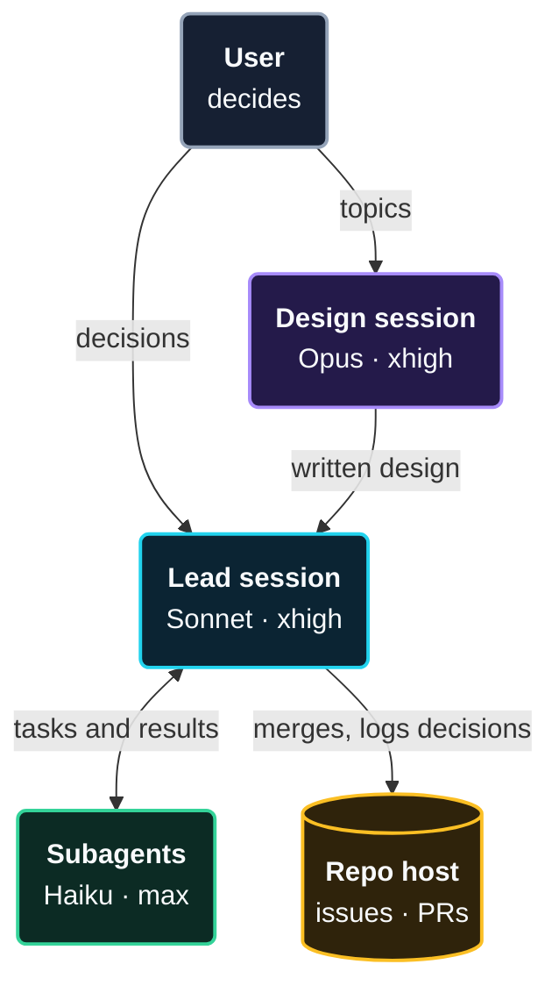

# Inter-session management

Three roles, each with a fixed model and effort: a Design session works a topic out, one Lead builds it, subagents do the small tasks. The setup enforces the roles; it does not rely on people remembering them.

> [!NOTE]
> Install: copy [`inter-session/.claude/`](../inter-session/.claude) into your repo, or [`both/.claude/`](../both/.claude) to add the compaction setup of [intra-session management](intra-session-management.md). The hook needs `jq`.

## The roles

| Role | Does | Model | Effort | How many |
|---|---|---|---|---|
| **Design** | works one topic out with the user and writes the design (doc or issue) | Opus | xhigh | one per topic |
| **Lead** | turns the design into the product: delegates, reviews code quality and results against the goal, merges, releases | Sonnet | xhigh | one per product |
| **Subagents** | each does one small, well-defined task and returns the result | Haiku | max | many, short-lived |

## How they work together



## The rules

1. **One topic per session.** A session stays small and its summaries stay accurate.
2. **One Lead per product.** Only the Lead merges to `main` and releases, so parallel sessions never compete for it.
3. **Design hands over a written design,** never code in `main`.
4. **Subagents return a result,** not a conversation, in the most minimal, clean code. The Lead reviews code quality and results against the goal and owns what gets merged.
5. **Durable state lives on the repo host** (issues, decision log, PRs), not in a session. A new session starts from there.
6. **Sessions message each other rarely:** for hand-overs, and for "`main` moved" or "release shipped".
7. **A topic moves by hand-over file:** at most 30 lines with running work, open questions, next steps and open PRs. The file lives outside the repository, for example `~/.claude/projects/<project>/handoff/<topic>.md`. A new session told "continue from `<topic>`" reads it first.
8. **Close a session** when its topic is done.

## Why these models

- **Design on Opus:** open-ended work with few turns and the hardest thinking. The strongest model at high effort.
- **Lead on Sonnet:** long-running orchestration with many turns. A mid-size model keeps every turn cheaper.
- **Subagents on Haiku:** many small, bounded tasks. A fast model at maximum effort does small tasks carefully.

## Enforce the design

Five layers, from the files every role needs to the optional team-wide lock:

1. **Role file with `model`** fixes the session's model. *Tested.*
2. **Launch command with `--effort`** fixes the session's effort. *Flag documented.*
3. **Subagent file with `model` and `effort`** fixes the subagent. *Model tested, effort documented.*
4. **Hook on subagent calls** restricts which subagents run and blocks per-call overrides. *Tested.*
5. **Managed settings (Team plan)** set the allowed models and the subagent model. *Documented.*

### 1. Role files

One file per role in [`.claude/agents/`](../inter-session/.claude/agents): `design.md`, `lead.md` and `worker.md`. The role is the file; the model comes from its frontmatter. `lead.md`:

```markdown
---
name: lead
description: Lead role
model: sonnet
effort: xhigh
---
You are the only session that merges to `main` and releases.
Delegate coding to the `worker` subagent. Log decisions on the repo host.
You are responsible for reviewing the code quality and the results: check that
what the workers deliver reaches the desired goal before you merge it.
Make no mistakes.
```

`design.md` is the same with `model: opus` and the Design instructions.

### 2. Launch commands

Start each role by its command, so the model and effort cannot depend on who starts it:

```bash
alias claude-design='claude --agent design --effort xhigh'
alias claude-lead='claude --agent lead --effort xhigh'
```

### 3. Subagent file

[`.claude/agents/worker.md`](../inter-session/.claude/agents/worker.md):

```markdown
---
name: worker
description: Worker for small, well-defined tasks. Use for any small task.
model: haiku
effort: max
---
Do exactly the task in the prompt. Return the result, not questions.
**Minimal, clean code.** The most minimal, cleanest code, expressive, modular
and clean in style and shape.
Make no mistakes.
```

The `effort` setting key does not accept `max`, so the subagents' `max` comes from this file.

### 4. The hook

The Lead could still call a general-purpose subagent, which inherits the Lead's model, or pass a model per call. A hook on the Agent tool closes both. It is registered in [`.claude/settings.json`](../inter-session/.claude/settings.json):

```json
{ "hooks": { "PreToolUse": [ { "matcher": "Agent",
    "hooks": [ { "type": "command",
      "command": "bash \"$CLAUDE_PROJECT_DIR\"/.claude/hooks/lock-agent.sh" } ] } ] } }
```

and the script, [`.claude/hooks/lock-agent.sh`](../inter-session/.claude/hooks/lock-agent.sh):

```bash
#!/usr/bin/env bash
# .claude/hooks/lock-agent.sh: allow only the defined subagents, with no per-call overrides.
in=$(cat)
type=$(jq -r '.tool_input.subagent_type // ""' <<<"$in")
over=$(jq -r '.tool_input | has("model") or has("effort")' <<<"$in")
case "$type" in worker) ;; *) echo "Blocked: use the 'worker' subagent, not '$type'." >&2; exit 2 ;; esac
[ "$over" = true ] && { echo "Blocked: do not pass model or effort; the subagent file fixes them." >&2; exit 2; }
exit 0
```

The script needs `jq` on the `PATH`. Exit code 2 blocks the call and shows the message to the model, which then retries correctly.

### 5. Managed settings (optional)

Organisation owners on the Team plan can push settings to all members from the Claude Code section of the organisation settings in claude.ai:

- **`availableModels` with `enforceAvailableModels`:** only the listed models can run, subagents included.
- **`CLAUDE_CODE_SUBAGENT_MODEL` with `CLAUDE_CODE_SUBAGENT_MODEL_FORCE=1`:** one model for all subagents, ignoring files and per-call values.

> [!WARNING]
> Three limits to know:
> - Users can run `/model` and `/effort` inside a session, so layers 1 and 2 fix the start, not the whole session.
> - `maxEffortLevel` is a ceiling with no floor, and it caps subagents too. Do not set it below `max` while subagents run `max`.
> - `CLAUDE_CODE_EFFORT_LEVEL` forces one effort on everything. Leave it unset.

## Verify

1. **Start `claude-lead`** and run `/model`. Expect Sonnet.
2. **Ask the Lead to call a general-purpose subagent.** The hook blocks it with its message.
3. **Ask it to call `worker` with `model: opus`.** Blocked.
4. **Ask it to call `worker`,** then run `jq -r 'select(.type=="assistant") | .message.model' ~/.claude/projects/<project>/<session>/subagents/*.jsonl | sort | uniq -c`. The call works and every turn shows Haiku.

> [!NOTE]
> Tested with Claude Code 2.1.322 (November 2026): layers 1, 3 (model) and 4, by headless runs that read the model from the session and subagent transcripts. The effort level has no headless read-back; check it in the session.

## Changelog

| Version | Date | Changes |
|---|---|---|
| 1.2 | 2026-11-12 | Install folders `inter-session/` and `both/`; the hook runs through `bash` |
| 1.1 | 2026-11-12 | Lead reviews code quality and results; workers write minimal, clean code; both make no mistakes |
| 1.0 | 2026-11-12 | Roles with fixed models and effort, hand-over, five enforcement layers |
