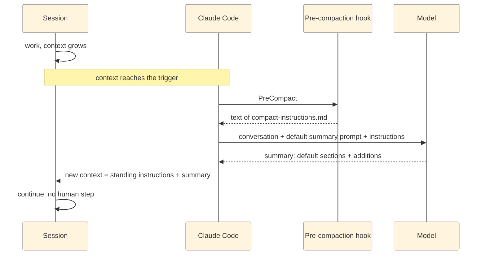

# Intra-session management

One session keeps working past its context limit and loses nothing it needs. Setup: one settings file and one instruction file, no scripts.

## The parts

| Part | Where | Job |
|---|---|---|
| Window and trigger | `.claude/settings.json` → `env` | decide when compaction fires |
| Pre-compaction hook | `.claude/settings.json` → `hooks.PreCompact` | hands the instruction file to Claude Code |
| Instruction file | `.claude/compact-instructions.md` | names what the summary keeps in addition to its defaults |

## The settings

```json
{
  "env": {
    "CLAUDE_CODE_AUTO_COMPACT_WINDOW": "280000",
    "CLAUDE_AUTOCOMPACT_PCT_OVERRIDE": "93"
  },
  "hooks": {
    "PreCompact": [
      { "hooks": [{ "type": "command",
          "command": "cat \"$CLAUDE_PROJECT_DIR\"/.claude/compact-instructions.md" }] }
    ]
  }
}
```

The hook has no matcher, so it runs for automatic and manual (`/compact`) compactions alike.

## How a compaction runs



## What the summary keeps

| Kept by default | Added by the instruction file |
|---|---|
| Request and intent | Open questions to the user, each with options and a recommendation, marked "not decided" |
| Technical concepts | Running work: each job, agent or run, with its ID and the exact command to check it |
| Files and code | |
| Errors and fixes | |
| All user messages | |
| Pending tasks, current work, next step | |

The default summary already carries the request, the files, the errors, the user's messages and the next step. The file adds the two things an autonomous session needs to continue correctly.

## Tune it

| Knob | Effect | Here |
|---|---|---|
| `CLAUDE_CODE_AUTO_COMPACT_WINDOW` | the window compaction is measured against (100k to 1M tokens) | 280000 |
| `CLAUDE_AUTOCOMPACT_PCT_OVERRIDE` | the share of the window that triggers it; it can only lower the threshold | 93 |
| Instruction file | the additions to the summary; at most 10,000 characters | 2 items |

Measured with these values: compaction fires at about 240k to 250k tokens. The summary needs room, so the trigger sits below window × percentage.

## Where the settings live

| File | Applies to |
|---|---|
| `.claude/settings.json` in the repo | everyone working in the repo |
| `.claude/settings.local.json` | one person, this repo |
| `~/.claude/settings.json` | one person, all projects |
| any file, started with `claude --settings <file>` | the sessions started with that flag |

A change applies from the next session start.

## Verify

| # | Step | Result |
|---|---|---|
| 1 | Start a new session in the repo and ask it to run `echo $CLAUDE_CODE_AUTO_COMPACT_WINDOW $CLAUDE_AUTOCOMPACT_PCT_OVERRIDE` | `280000 93` |
| 2 | Run `/compact` | the summary contains the two added sections |

## Why it works

- **Automatic compaction** keeps a session running without interruption: Claude Code replaces the conversation with a summary and the session goes on with the same identity.
- **The hook** makes the instructions part of every compaction. Claude Code runs it right before it summarises and uses its output as instructions for the summary.
- **The file adds to the default summary,** so the defaults stay intact.
- **Claude Code decides when to compact,** from the configured window. No other part watches the context size.
- **A lower window keeps every turn small.** The context re-sent with each turn stays near the trigger instead of growing toward the model's maximum, and a session with one topic needs about one compaction at most.

## Changelog

| Version | Date | Changes |
|---|---|---|
| 1.0 | 2026-11-12 | Settings, pre-compaction hook and instruction file |
